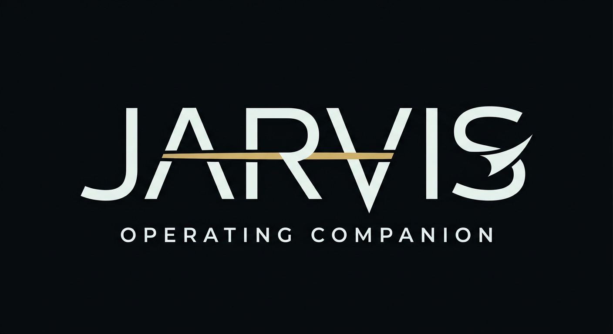

<p align="center">
  
</p>

<p align="center">
  <strong>A local-first AI system that can see, speak, remember, and act.</strong>
</p>

<p align="center">
  <a href="https://jarvis-khaki-eight.vercel.app/">Website</a> ·
  <a href="https://jarvis-khaki-eight.vercel.app/docs/">Documentation</a> ·
  <a href="docs/PRIVACY.md">Privacy</a> ·
  <a href="https://github.com/mafk21/OS/issues">Issues</a>
</p>

---

## What is JARVIS?

JARVIS turns your computer into an AI-operated workspace. Speak or type a goal and it can understand your screen, use applications, work with files, research, write and run code, coordinate specialist agents, and complete long-running tasks with visible progress.

It is open source and runs on **Windows, macOS, and Linux**.

## Highlights

- **Voice, text, and vision** — full-duplex conversation, interruption, typed input, and screen understanding.
- **Computer control** — applications, browser, terminal, files, keyboard, mouse, clipboard, media, and system controls.
- **Durable memory** — local timelines, preferences, documents, commitments, learning records, and searchable history.
- **Long-running work** — specialist workers, checkpoints, cancellation, recovery, progress, and verified outputs.
- **Connected services** — optional integrations for mail, calendars, drives, messaging, development tools, productivity platforms, REST, webhooks, and MCP.
- **Owner control** — confirmation gates, encrypted credentials, scoped tools, audit history, and explicit privacy controls.
- **Two equal editions** — Guardian and Confidante offer different presentation styles with the same capabilities, safeguards, and reliability.

For the complete feature guide and architecture, visit the **[documentation website](https://jarvis-khaki-eight.vercel.app/docs/)**.

## Install

Requires **Python 3.11 or 3.12**. Newer Python releases may not yet have Windows wheels for all native dependencies.

```bash
git clone https://github.com/mafk21/jarvis.git
cd jarvis
python setup.py
python main.py
```

On Windows, use `py` if `python3` is unavailable.

After setup, launch JARVIS with the native script for your system:

| Platform | Launcher |
| --- | --- |
| Windows | `Start_JARVIS.bat` |
| macOS | `./Start_JARVIS.command` |
| Linux | `./Start_JARVIS.sh` |

Configure OpenAI, Gemini, or supported local AI components during onboarding. Credentials and model files are not included in the repository.

## Local-first, clearly

The interface, orchestration, memory, tools, automations, credential vault, and action history run locally. Cloud models and connected services receive data only when you configure and use them. A completely local setup requires local model, speech-to-text, and text-to-speech components.

Read **[Privacy and Data Flow](docs/PRIVACY.md)** before connecting accounts or enabling remote features.

## Development

```bash
python -m pytest -q
python install_jarvis.py --check
```

HUD development and build instructions are available in the **[documentation](https://jarvis-khaki-eight.vercel.app/docs/)**.

## Contributing and support

Issues and focused pull requests are welcome. Read [CONTRIBUTING.md](CONTRIBUTING.md) before making changes and use [SUPPORT.md](SUPPORT.md) for help and bug-report guidance.

1. Keep Windows, macOS, and Linux behavior aligned.
2. Do not commit credentials, runtime databases, memories, recordings, or generated user data.
3. Run the relevant tests and report real results.
4. Update documentation when behavior changes.

Security vulnerabilities must not be posted publicly. Follow the private reporting process in [SECURITY.md](SECURITY.md).

## Release status

JARVIS is currently public beta software. Use the latest release, review permissions before approving sensitive actions, and expect rapid changes while installation and packaging mature.

## License

JARVIS OS is released under the [MIT License](LICENSE).
